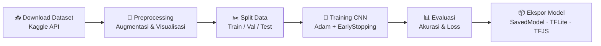

<div align="center">

# 🐾 Klasifikasi Gambar Hewan dengan CNN

**Mengenali kucing, anjing, gajah, kuda, dan singa dari gambar menggunakan Deep Learning**


</div>

---

## 📌 Daftar Isi

- [Tentang Proyek](#-tentang-proyek)
- [Dataset](#-dataset)
- [Alur Pengerjaan](#-alur-pengerjaan)
- [Arsitektur Model](#-arsitektur-model)
- [Hasil](#-hasil)
- [Format Model](#-format-model)
- [Cara Menjalankan](#-cara-menjalankan)
- [Contoh Penggunaan](#-contoh-penggunaan)
- [Pengembangan Selanjutnya](#-pengembangan-selanjutnya)

---

## 🎯 Tentang Proyek

Proyek ini membangun model **Convolutional Neural Network (CNN)** untuk mengklasifikasikan gambar ke dalam 5 kelas hewan. Model dilatih dari nol dengan TensorFlow/Keras, lalu diekspor ke tiga format (SavedModel, TF-Lite, dan TensorFlow.js) agar bisa dipakai di server, aplikasi mobile, maupun web.

| 🐱 Cat | 🐶 Dog | 🐘 Elephant | 🐴 Horse | 🦁 Lion |
|:---:|:---:|:---:|:---:|:---:|

## 🗂️ Dataset

- **Sumber:** [Animals Dataset di Kaggle](https://www.kaggle.com/datasets/antobenedetti/animals)
- **Total:** 14.971 gambar, 5 kelas, distribusi relatif seimbang

| Kelas | Jumlah Gambar |
|:------|:-------------:|
| 🐱 Cat | 3.037 |
| 🐶 Dog | 2.927 |
| 🐘 Elephant | 3.029 |
| 🐴 Horse | 3.005 |
| 🦁 Lion | 2.973 |

### Contoh Gambar per Kelas

<div align="center">


</div>

### Distribusi Data

<div align="center">

</div>

## 🔄 Alur Pengerjaan



**Augmentasi** yang digunakan: rotasi, flip, shear, warp shift, blur, dan perubahan kecerahan. Pada `ImageDataGenerator` ditambahkan rotasi, zoom, dan horizontal flip.

## 🧠 Arsitektur Model

```
Input (64×64×3)
   │
   ├─ Conv2D(32)  → BatchNorm → MaxPool
   ├─ Conv2D(64)  → BatchNorm → MaxPool
   ├─ Conv2D(128) → BatchNorm → MaxPool
   ├─ Conv2D(256) → BatchNorm → MaxPool
   │
   ├─ Flatten
   ├─ Dense(1024) → Dense(512) → Dense(256)
   └─ Dense(5, softmax)
```

| Parameter | Nilai |
|:----------|:------|
| Total parameter | 2.097.349 (±8 MB) |
| Optimizer | Adam |
| Loss | Categorical Crossentropy |
| Regularisasi | L2 (0.01) + BatchNormalization |
| Batch size | 64 |
| Epoch maksimum | 30 |
| Callback | EarlyStopping, ReduceLROnPlateau |

## 📈 Hasil

| Data | Jumlah Gambar | Akurasi |
|:-----|:-------------:|:-------:|
| Training | 9.653 | ±98% |
| Validasi | 2.411 | 89,96% |
| **Test** | 3.017 | **90,52%** |

<div align="center">


</div>

> 💡 Selisih akurasi training dan validasi menunjukkan model cenderung *overfitting* ringan.

## 📦 Format Model

| Format | Lokasi | Kegunaan |
|:-------|:-------|:---------|
| SavedModel | `saved_model/` | Deployment server (TF Serving) |
| Keras H5 | `cnn_image_classification.h5` | Memuat ulang model di Python |
| TF-Lite | `tflite/model.tflite` | Aplikasi mobile / edge device |
| TensorFlow.js | `tfjs_model/` | Aplikasi web di browser |

## 🚀 Cara Menjalankan

```bash
# 1. Clone repositori
git clone https://github.com/<username>/<nama-repo>.git
cd <nama-repo>

# 2. Pasang dependensi
pip install -r requirements.txt
```

Lalu buka `MiftahStudent_Submission_Akhir.ipynb` di Google Colab atau Jupyter Notebook, siapkan `kaggle.json` (API token Kaggle Anda), dan jalankan semua sel secara berurutan.

## 🔍 Contoh Penggunaan

```python
import numpy as np
from tensorflow.keras.models import load_model
from tensorflow.keras.preprocessing import image

kelas = ["cat", "dog", "elephant", "horse", "lion"]
model = load_model("cnn_image_classification.h5")

img = image.load_img("contoh.jpg", target_size=(64, 64))
x = image.img_to_array(img) / 255.0
x = np.expand_dims(x, axis=0)

pred = model.predict(x)
print(f"Prediksi: {kelas[np.argmax(pred)]} ({np.max(pred)*100:.1f}%)")
```

## 🔭 Pengembangan Selanjutnya

- [ ] Mencoba *transfer learning* (MobileNet / DenseNet121) untuk akurasi lebih tinggi
- [ ] Memperbesar resolusi input dari 64×64
- [ ] Membagi data sebelum augmentasi agar evaluasi lebih objektif
- [ ] Membuat demo web dengan model TensorFlow.js

## 👤 Author

**MiftahStudent** · Dicoding: Miftah Student

---

<div align="center">⭐ Jika proyek ini bermanfaat, jangan lupa beri bintang! ⭐</div>
